<p align="center">
  <picture>
    <source media="(prefers-color-scheme: dark)" srcset="assets/hero-dark.svg">
    
  </picture>
</p>

> [!NOTE]
> **Reference machine:** an older mid-range MacBook Pro (dual-core x86, 8 GB RAM), CPU only.
>
> **Qwen3.6-35B-A3B** (35B MoE): ~2 tokens/sec in ~2 GB of resident RAM. **Qwen3.5-2B** (dense): 8.32 tokens/sec from a cold start, ~1.9 GB in RAM.
>
> Speed rises with warm-up and with storage and memory bandwidth. Bandwidth-derived ceiling for the 35B on this class of hardware: ~10-15 tokens/sec.
>
> Fully offline: the engine contains no network code. Only shardpress uses the network, to download weights.
>
> This is experimental: the 35B's experts are converted to ternary without retraining, so its answers may differ from the original model.

## The system

<p align="center">
  <picture>
    <source media="(prefers-color-scheme: dark)" srcset="assets/system-dark.svg">
    
  </picture>
</p>

**shardpress** downloads a model one shard at a time, hands each shard to holopress, verifies the result and deletes the raw shard. It pauses and resumes at any point, survives power loss, and writes the engine's settings (`model.cfg`, `vocab.bin`) when the last shard is done. Progress shows in the terminal and on a status page in the default browser (`--no-browser` skips the page).

**holopress** presses each shard into the plate. Experts become ternary bitplanes (-1, 0, +1) with one scale per group of 128 weights, about 2.1 bits per weight. Everything else is copied exactly. Every piece is written atomically with a checksum, so an interrupted run resumes without redoing verified work.

**The engine** (`holomoe.c`, binary `holomoe`) runs inference in pure C:

- Hybrid attention, as in the reference model: Gated DeltaNet linear attention in 3 of every 4 layers (a fixed-size memory per head, so long conversations stay cheap) and gated full attention every 4th layer.
- 256 routed experts per layer (top 8) plus one always-on shared expert. Experts are memory-mapped zero-copy from the plate and paged in per token. Ternary math runs on popcount.
- An 8-bit fast-boot copy of the always-used weights is built on first run. After that, boot takes seconds.
- Next-layer experts are predicted and requested from the SSD early. A heat map keeps the most-used experts warm in RAM.
- Speculative decoding: a guessing memory proposes the next few tokens and the model verifies them in one pass. Accepted tokens are exactly what the model would have written on its own. Guessing switches on once warm-up shows it helps on the machine, or by hand with `--guess N`.
- On x86, int8 math is AVX2-vectorized. ARM builds use the portable math path.

**holotrain** is the warm-up trainer. It never changes model weights. It learns which experts to keep warm, which phrases to guess, and the fastest settings that hold quality, including whether guessing pays off on that machine. Feed it PDF, Word, Markdown, ePub, plain text, code and images (via macOS OCR). Fed files become practice questions and searchable passages that the engine draws on in chat. A live page in the default browser shows speed, guess-hit rate and hardware ceilings, with pause, resume and stop.

## Models

- **35b** (default): Qwen3.6-35B-A3B. 256 experts, top 8, 40 layers. Plate: 14.6 GB. Measured: 2.01 tokens/sec after warm-up.
- **2b**: Qwen3.5-2B. Dense, 24 layers. Plate: 5.5 GB. Runs fully in RAM (~1.9 GB) and boots in about 6 seconds. Measured: 8.32 tokens/sec cold, no warm-up needed.
- **30b** (optional): Qwen3-30B-A3B, for machines with more headroom.

Each model lives in its own plate folder (`plate`, `plate-2b`, `plate-30b`) with its own learning and stats. Choose one with `--model`.

Other Qwen3.5/3.6 (MoE and dense) and Qwen3 models load through the same path with a menu entry in `shardpress.py`.

## Why it fits in 2 GB

The 35B model activates about 3B parameters per token: 8 of 256 experts per layer, plus the shared expert. Only attention and shared weights stay resident (~2 GB at int8; `--lean` switches attention to 4-bit for about half that). The experts are read from the SSD only when routed to, and spare RAM caches the hottest ones.

## Speed and warm-up

A forward pass costs about the same whether it yields one token or several, so tokens/sec tracks the guess-hit rate.

Measured on the reference machine:

**2B (dense)**
- cold start, no warm-up: 8.32 tokens/sec (6.88 words/sec), ready to chat in 6.3 seconds

**35B (MoE)**
- cold: ~1 token/sec
- after warm-up on ~50 documents: 2.01 tokens/sec (1.61 words/sec), 28% of guessed tokens accepted

Further warm-up raises the hit rate and the speed of either model.

Bandwidth-derived ceilings for the 35B on the same machine:

- one token per pass: ~7 tokens/sec
- with speculative decoding: ~10-15 tokens/sec

Faster storage and memory raise every number.

## Setup

The tools keep their files in `~/holomoe`, so clone there:

```
git clone https://github.com/rayj3088/hypogeum.c ~/holomoe
cd ~/holomoe
make                          # builds holopress and the engine for this CPU
python3 shardpress.py models  # list models and sizes
python3 shardpress.py all     # download and press the 35B (or: all --model 2b)
./holomoe                     # chat (or: ./holomoe --model 2b)
```

The first boot builds a fast-boot copy of the always-used weights (a few minutes, once). `/help` lists every chat command.

Free disk needed: about 20 GB for the 35B, about 11 GB for the 2B (the plate plus one shard in flight). The 35B downloads about 67 GB in total; `python3 shardpress.py models` lists the size of each model.

Other shardpress commands: `test` (one-shard trial run), `1-7` (a range of shards), `status`.

## Warm-up

```
python3 holotrain.py                    # run until Stop
python3 holotrain.py 30m --turbo        # timed; modes: --turbo, --precise, --auto
python3 holotrain.py 2h --target 4      # stop once it reaches 4 tokens/sec
python3 holotrain.py --feed paper.pdf   # feed any file
python3 holotrain.py 10m --model 2b     # warm up another model (each keeps its own learning)
python3 holotrain.py 10m --no-browser   # terminal progress only
```

What it learns is saved in the plate folder as it goes (`heat.bin`, `draft.tok`, `tuned.cfg`) and loaded by the engine at boot. Stopping at any moment is safe.

## Chat commands

- `/help` every command
- `/stats` session and all-time speed, guessing and RAM hits
- `/card` one-screen summary of machine, model and speeds
- `/think on|off` show reasoning (math, logic, code)
- `/short` `/medium` `/long` `/full` answer length; `/lines N` exact line limit
- `/search on|off` draw on passages from fed files (on by default)
- `/reset` new conversation, `/save` save learning, `/quit` exit and save

## Start options

- `-p "question"` one answer, then exit
- `--model 35b|2b|30b` choose a model
- `--lean` 4-bit attention, about half the resident RAM
- `--temp 0.7`, `--seed N`, `-n 200`, `--repeat-penalty 1.5`
- `--ctx 4096` conversation memory, `--preload GB` warm experts at boot
- `--think`, `--plain`, `--raw`, `--full-vocab`, `--no-learn`

`./holomoe --help` lists everything.

## Verification

- `./holomoe --ppl file.txt` scores quality as perplexity (lower is better).
- `test/run_arch.sh WORKDIR moe35|dense|qwen3moe` builds a tiny mock checkpoint with real tensor names and layout, runs it through holopress, holomoe_meta and the engine, and compares the engine's logits against an independent numpy forward pass written from the official modeling code.
- `--bf16 --float-act --no-simd --no-predict` run slower exact reference paths for comparison.

## Requirements

Install one model or both. Each one stands alone.

**2b**
- Memory: ~1.9 GB (the whole model sits in RAM)
- Free disk: ~11 GB

**35b**
- Memory: ~2 GB resident (attention and shared weights), plus spare RAM the OS lends as cache for hot experts, ~4-5 GB in use in total while writing. The cache adapts to whatever RAM is free.
- Free disk: ~20 GB (the plate plus one shard in flight)
- Download: ~67 GB in total, one shard at a time

**Reference machine** (every number in this README): dual-core x86 MacBook Pro, 8 GB RAM, SSD, macOS 12.

**Software**
- A C compiler (Xcode command-line tools on macOS, gcc on Linux)
- Python 3, standard library only (numpy for the test suite)
- curl
- Any browser, optional: status pages open in the default browser, and `--no-browser` keeps everything in the terminal

**Platforms**

The build file picks the right path per CPU: Intel and AMD get native tuning with AVX2 fast paths; ARM, including Apple Silicon and Raspberry Pi, builds on the portable math path. Linux builds use OpenMP.

- macOS and Linux on Intel, AMD and ARM, including Apple Silicon; Windows through WSL
- Image feeding in holotrain uses macOS OCR

## Related work

Streaming mixture-of-experts weights from storage is an active area: LLM in a Flash, MoE-Infinity, HOBBIT and QMoE in research, and llama.cpp's memory-mapped weights in practice. hypogeum.c targets older, low-memory machines: ternary experts made without retraining, warm-up instead of fine-tuning, and a dependency-free C engine.

## Credits

- Model weights: the Qwen team at Alibaba Cloud (Qwen3.6-35B-A3B, Qwen3.5-2B, Qwen3-30B-A3B), used under Qwen's license.
- Gated DeltaNet: Yang, Kautz and Hatamizadeh, "Gated Delta Networks: Improving Mamba2 with Delta Rule," 2024.
- Streaming weights from flash: Alizadeh et al., "LLM in a Flash: Efficient Large Language Model Inference with Limited Memory," Apple, 2023.
- Speculative decoding: Leviathan, Kalman and Matias, "Fast Inference from Transformers via Speculative Decoding," 2023; Chen et al., "Accelerating Large Language Model Decoding with Speculative Sampling," 2023.
- Drafting from a text corpus: He et al., "REST: Retrieval-Based Speculative Decoding," 2023.
- Ternary weights: Ma et al., "The Era of 1-bit LLMs: All Large Language Models are in 1.58 Bits," 2024.
- Expert prefetching: Hwang et al., "Pre-gated MoE," 2024.
- Related: Xue et al., "MoE-Infinity: Offloading-Efficient MoE Model Serving," 2024; Tang et al., "HOBBIT: A Mixed Precision Expert Offloading System for Fast MoE Inference," 2024; Frantar and Alistarh, "QMoE: Practical Sub-1-Bit Compression of Trillion-Parameter Models," 2023.

## License

MIT for the code. Model weights carry their own license.
